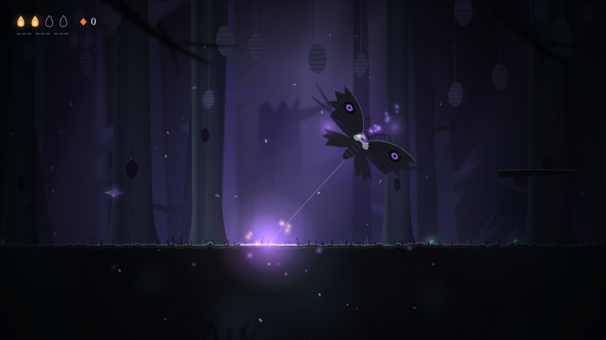
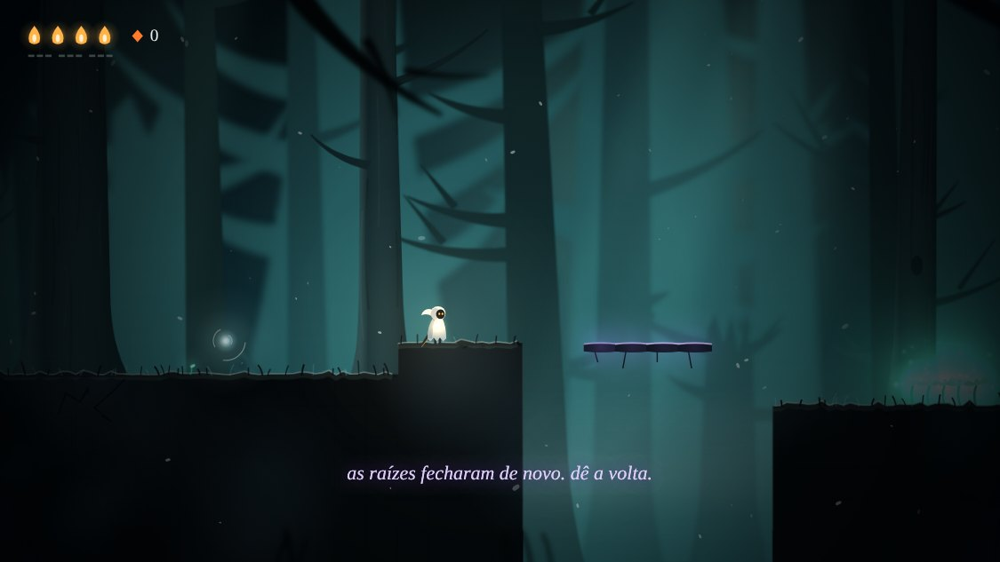

# Sono de Cinza

Uma figura pequena atravessa uma floresta queimada e silenciosa. Cada morte é um pesadelo do qual
você acorda, e os poucos que restam lembram de já ter te matado.

Metroidvania 2D com lutas punitivas, feito para rodar no navegador do computador e no navegador do
Android. É uma fatia: uma área de onze salas, do despertar até a guardiã final, com um caminho
lateral que desce até um lago de fuligem e um ninho.

## Jogar

Abra o `index.html` no navegador. Não precisa de servidor, instalação nem internet.

| Ação | Teclado | Android | Controle |
| --- | --- | --- | --- |
| Andar | Setas ou A/D | Botão largo à esquerda | Direcional ou alavanca |
| Pular (segure para ir mais alto) | Z ou Espaço | Seta para cima, à direita | A |
| Segundo pulo, no ar, depois de ganhar as asas | Z ou Espaço de novo | O mesmo botão de novo | A de novo |
| Golpear | X | Botão da lâmina | X |
| Golpear para cima | ↑ + X | Seta pequena à esquerda + lâmina | Cima + X |
| Golpear para baixo, no ar (acertando, você quica) | ↓ + X | Botão da chama + lâmina | Baixo + X |
| Ímpeto, depois de ganho | C | Botão das duas setas | B ou gatilho direito |
| Curar, parado, gastando calor | Segurar ↓ | Segurar o botão da chama | Segurar baixo ou Y |
| Pausa e mapa | P | Botão de pausa | Start |
| Som | M | Botão do alto-falante | |

No Android os botões aparecem no primeiro toque na tela, a câmera fica mais perto da figura (e abre
nas lutas de guardião) e o aparelho treme ao levar dano. Um controle Bluetooth também funciona, no
celular e no computador. O progresso fica salvo no próprio navegador.

## APK para Android

O APK mais recente fica sempre no mesmo endereço:

https://github.com/jv43291-boop/Project_Sono_Cinzas/releases/download/apk/sono-de-cinza.apk

Baixe no celular e abra o arquivo para instalar; o Android pede para permitir a instalação de apps
dessa fonte. Uma versão nova instala por cima da antiga e mantém o progresso.

O GitHub Actions monta o APK a cada mudança no jogo ou na pasta `android/`
(`.github/workflows/apk.yml`). O app é só uma tela cheia que abre o mesmo `index.html` do navegador.
Ele é assinado com uma chave de teste guardada no repositório (`android/chave-de-teste.jks`): serve
para instalar e atualizar o protótipo, não para publicar em loja.

## O que tem na fatia

- Onze salas ligadas, com quatro brotos de save automático, um atalho e dois segredos.
- Três inimigos, cada um atacando de um jeito: a carcaça, a mariposa de fuligem e o espinheiro.
- Três guardiões: o Vigia Oco, que guarda o ímpeto; a Rainha de Fuligem, no ninho, que guarda as
  asas de cinza (o segundo pulo); e a Enlutada, no fim. Com metade da vida, cada um enfurece.
- Duas travas: a ravina do começo só abre com o ímpeto, e o muro antes da Enlutada só com as asas.
- A morte como pesadelo: a tela se rasga num vórtice violeta e você acorda no último broto.
- Inimigos que lembram: a partir da segunda morte para o mesmo inimigo, ele fala, e comenta o jeito
  como você morreu. A partir da quarta, ele muda o jeito de lutar. A pausa mostra o registro.
- Sete ecos espalhados pelas salas contam, aos pedaços, o que queimou a floresta.

## O Sono

Depois da primeira morte, alguma coisa passa a acompanhar você. O Sono é um diretor que roda dentro
do jogo, sem modelo de IA e sem internet (`director.js`). Ele anota onde você morre, por onde passa,
quanto demora e que golpe usa mais, e a partir disso:

- ao trocar de sala, às vezes mexe nos inimigos: põe um a mais onde não havia, manda mais do que mais
  te matou, troca os do chão de tipo, acorda todos antes de você chegar, ou esvazia a sala e cobra na
  próxima. Quem você deixa vivo e desperto pode atravessar a porta atrás de você;
- entre uma morte e outra, às vezes mexe no chão: espinhos nascem e somem, os troncos do lago mudam
  de lugar, o atalho fecha e uma ponte abre sobre a ravina;
- depois de três mortes seguidas na mesma sala, cede alguma coisa;
- onde você morreu fica um resto de calor, que dá para pegar de volta;
- sussurra, em momentos que ninguém marcou, frases montadas na hora a partir do que viu.

Ele nunca mexe nas salas dos guardiões nem nas salas calmas de broto, e toda mudança de chão sai de
um conjunto conferido para ser passável nos dois sentidos. As falas saem de um repertório escrito, e
não de um modelo. Em `config.js`, `director` desliga tudo e os valores `director_*` ajustam o ritmo.

## Arquivos

| Arquivo | O que é |
| --- | --- |
| `index.html` | O jogo: passo fixo, entrada, colisão, inimigos, cenas |
| `config.js` | Todos os números de ajuste (velocidade, vida, dano, tempos), cada um com mínimo e máximo |
| `world.js` | As onze salas, em blocos de 40 px, os ecos e as frases dos inimigos |
| `art.js` | A arte, toda desenhada em código: camadas, figuras, o vórtice |
| `sfx.js` | O som, gerado por código: vento, notas, efeitos |
| `director.js` | O Sono: o diretor que acompanha o jogador, muda inimigos e caminhos e sussurra |
| `android/` | O app Android: uma tela cheia que abre o jogo |
| `docs/game-brief.md` | O brief de uma página que deu origem ao jogo |
| `docs/screenshots/` | Imagens do jogo |
| `references/notes.md` | O que cada imagem de referência deu ao visual |

## Para testar uma sala direto

Acrescente ao endereço do `index.html`:

- `?room=R5&impeto=1` começa numa sala (de `R1` a `R11`), já com o ímpeto; `&asas=1` e `&lamina=1`
  dão as asas e a lâmina reforçada.
- `&x=20&y=14` escolhe o bloco onde a figura aparece.
- `?touch=1` mostra os botões de toque no computador; `&zoom=1.3` escolhe a aproximação da câmera.
- `?scene=figures` mostra todas as figuras lado a lado.

Com `?room=` o jogo não grava save.

## Estado

Protótipo. A primeira versão foi jogada pelo dono do projeto; as novidades da segunda rodada (golpe
para baixo, fúria dos guardiões, inimigos que mudam, as três salas novas, a Rainha, os ecos, câmera
e vibração no celular, controle) foram conferidas só por passos roteirizados, não por jogo real. A
dificuldade vem de valores de partida do gênero; o som nunca foi ouvido por quem o escreveu. O Sono
(terceira rodada) também só foi conferido por passos roteirizados: cada caminho alterado foi
atravessado nos dois sentidos, mas se as mudanças parecem justas ou cansam é coisa que só jogando.

Construído com o fluxo `/prototype` do template Claude Code Game Studios.
