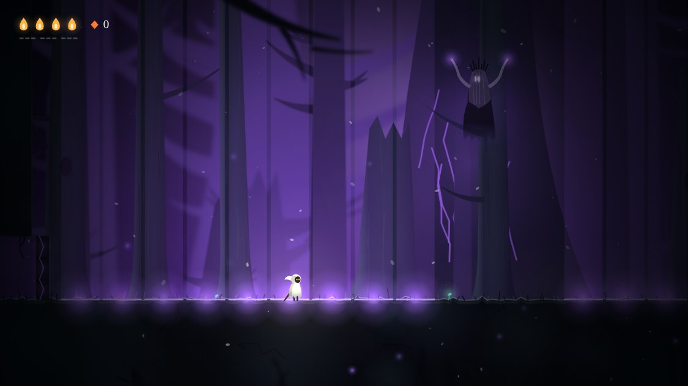

# Sono de Cinza

Uma figura pequena atravessa uma floresta queimada e silenciosa. Cada morte é um pesadelo do qual
você acorda, e os poucos que restam lembram de já ter te matado.

Metroidvania 2D com lutas punitivas, feito para rodar no navegador do computador e no navegador do
Android. É uma fatia: uma área de oito salas, do despertar até a guardiã final.

## Jogar

Abra o `index.html` no navegador. Não precisa de servidor, instalação nem internet.

| Ação | Teclado | Android |
| --- | --- | --- |
| Andar | Setas ou A/D | Botão largo à esquerda |
| Pular (segure para ir mais alto) | Z ou Espaço | Seta para cima, à direita |
| Golpear (com ↑, para cima) | X | Botão da lâmina |
| Ímpeto, depois de ganho | C | Botão das duas setas |
| Curar, parado, gastando calor | Segurar ↓ | Segurar o botão da chama |
| Pausa e mapa | P | Botão de pausa |
| Som | M | Botão do alto-falante |

No Android os botões aparecem no primeiro toque na tela. O progresso fica salvo no próprio navegador.

## APK para Android

O APK mais recente fica sempre no mesmo endereço:

https://github.com/jv43291-boop/Project_Sono_Cinzas/releases/download/apk/sono-de-cinza.apk

Baixe no celular e abra o arquivo para instalar; o Android pede para permitir a instalação de apps
dessa fonte. Uma versão nova instala por cima da antiga e mantém o progresso.

O GitHub Actions monta o APK a cada mudança no jogo ou na pasta `android/`
(`.github/workflows/apk.yml`). O app é só uma tela cheia que abre o mesmo `index.html` do navegador.
Ele é assinado com uma chave de teste guardada no repositório (`android/chave-de-teste.jks`): serve
para instalar e atualizar o protótipo, não para publicar em loja.

## O que tem na fatia

- Oito salas ligadas, com três brotos de save automático, um atalho e dois segredos.
- Três inimigos, cada um atacando de um jeito: a carcaça, a mariposa de fuligem e o espinheiro.
- Dois guardiões: o Vigia Oco, que guarda o ímpeto, e a Enlutada.
- A morte como pesadelo: a tela se rasga num vórtice violeta e você acorda no último broto.
- Inimigos que lembram: a partir da segunda morte para o mesmo inimigo, ele fala. As frases mudam
  conforme o número de mortes.

## Arquivos

| Arquivo | O que é |
| --- | --- |
| `index.html` | O jogo: passo fixo, entrada, colisão, inimigos, cenas |
| `config.js` | Todos os números de ajuste (velocidade, vida, dano, tempos), cada um com mínimo e máximo |
| `world.js` | As oito salas, em blocos de 40 px, e as frases dos inimigos |
| `art.js` | A arte, toda desenhada em código: camadas, figuras, o vórtice |
| `sfx.js` | O som, gerado por código: vento, notas, efeitos |
| `android/` | O app Android: uma tela cheia que abre o jogo |
| `docs/game-brief.md` | O brief de uma página que deu origem ao jogo |
| `docs/screenshots/` | Imagens do jogo |
| `references/notes.md` | O que cada imagem de referência deu ao visual |

## Para testar uma sala direto

Acrescente ao endereço do `index.html`:

- `?room=R5&impeto=1` começa numa sala (de `R1` a `R8`), já com o ímpeto.
- `&x=20&y=14` escolhe o bloco onde a figura aparece.
- `?touch=1` mostra os botões de toque no computador.
- `?scene=figures` mostra todas as figuras lado a lado.

Com `?room=` o jogo não grava save.

## Estado

Protótipo. A dificuldade vem de valores de partida do gênero e ainda não foi ajustada com jogo real;
o som nunca foi ouvido por quem o escreveu; nenhum aparelho Android rodou o jogo ainda.

Construído com o fluxo `/prototype` do template Claude Code Game Studios.
